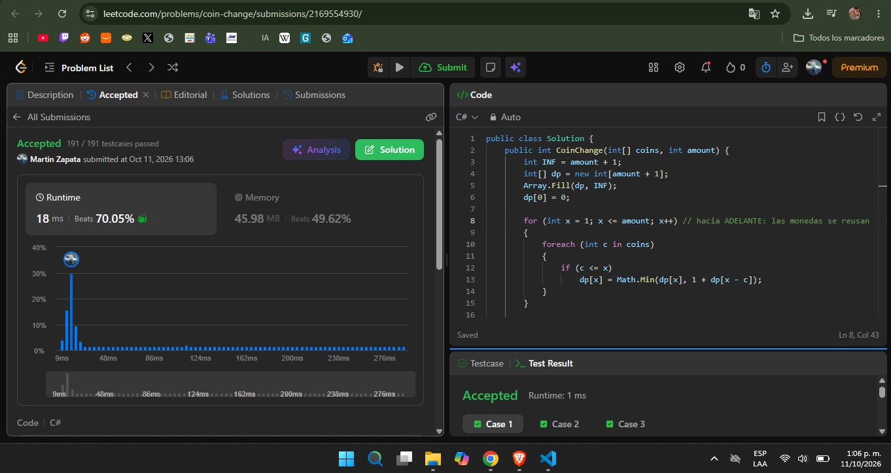
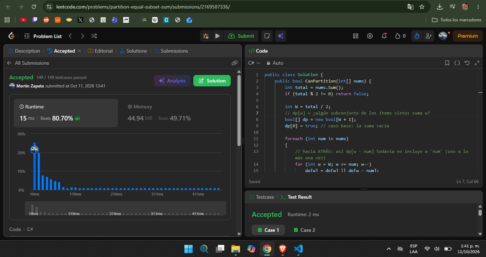

## Ejercicios Resueltos — Tarea 4: Programación Dinámica
 
### 1. [322. Coin Change](https://leetcode.com/problems/coin-change/)

* **Dificultad:** Medium
* **Código de la solución:** [Ver implementación en el repositorio](./coin-change/CoinChange.cs)

**Estado:** `dp[x]` = mínimo número de monedas necesarias para sumar exactamente `x`.

**Recurrencia:** `dp[x]` = min over c in coins, c <= x of ( 1 + `dp[x - c]` )

**Casos base:** `dp[0] = 0`. Las demás posiciones empiezan en `amount + 1` (equivale a ∞, porque ninguna solución real usa más de `amount` monedas). Si al final `dp[amount]` sigue en ese valor, la respuesta es `-1`.

**Reuso:** las monedas son **ilimitadas** (mochila no acotada). Por eso el `for` sobre el monto recorre **hacia adelante** (de `1` a `amount`): al calcular `dp[x]` se puede usar `dp[x - c]`, que ya pudo haber usado la misma moneda `c`.

**Por qué greedy falla:** con `coins = {1, 3, 4}` y `amount = 6`, greedy toma 4 + 1 + 1 = 3 monedas, pero la óptima es 3 + 3 = 2 monedas. El sistema no es canónico, así que la decisión local (la moneda más grande) no lleva al óptimo global; hay que comparar todas las opciones en cada estado.

**Complejidad** (con `k = coins.Length` y `amount` = monto):

- Tiempo: `Θ(k · amount)` (hay `amount` estados y `k` transiciones por estado).
- Espacio: `Θ(amount)`.
- Es pseudo-polinomial: depende del **valor** de `amount`, no del tamaño de su representación.

**Evidencia:**

---

### 2. [416. Partition Equal Subset Sum](https://leetcode.com/problems/partition-equal-subset-sum/)
 
* **Dificultad:** Medium
* **Código de la solución:** [Ver implementación en el repositorio](./partition-equal-subset-sum/PartitionEqualSubsetSum.cs)

**Reducción:** sea `S` la suma total. Si `S` es impar, es imposible partir en dos mitades iguales. Si es par, el problema es decidir si existe un subconjunto que sume exactamente `W = S / 2` (el resto suma lo mismo). Es una mochila 0/1 donde el valor coincide con el peso.

**Estado:** `dp[w]` = `true` si existe un subconjunto de los números ya considerados cuya suma es exactamente `w`.

**Recurrencia (al considerar `nums[i]`):** `dp[w]` = `dp[w]` OR dp[w - `nums[i]`] para w >= `nums[i]`

**Casos base:** `dp[0] = true` (la suma vacía); `dp[w] = false` para `w > 0` al inicio. La respuesta es `dp[W]`.

**Uso a lo más una vez (0/1):** cada número se puede tomar una sola vez. Al comprimir la tabla a un arreglo 1D, el `for` sobre `w` recorre **hacia atrás** (de `W` a `nums[i]`). Así `dp[w - nums[i]]` todavía corresponde a los ítems *anteriores* a `nums[i]`. Si se recorriera hacia adelante, `dp[w - nums[i]]` ya habría incorporado a `nums[i]` y se reusaría el mismo número (se convertiría en el problema 1).

**Complejidad** (con `n = nums.Length` y `W = S / 2`):

- Tiempo: `Θ(n · W)`.
- Espacio: `Θ(W)` con el arreglo 1D (`Θ(n · W)` si se conservara la matriz completa).
- También es pseudo-polinomial en `W`. Enumerar los `2^n` subconjuntos sería `O(n · 2^n)` y no es viable con `n` hasta 200.

**Evidencia:**

---

## Comparación: reuso vs. 0/1

| | Coin Change (322) | Partition Equal Subset Sum (416) |
| --- | --- | --- |
| Tipo | Mochila no acotada | Mochila 0/1 |
| Uso de cada pieza | Ilimitado | A lo más una vez |
| Dirección del `for` sobre el monto/capacidad | Hacia adelante | Hacia atrás |
| Estado | `dp[x]` = mín. monedas | `dp[w]` = ¿suma `w` alcanzable? |
| Tiempo / Espacio | `Θ(k · amount)` / `Θ(amount)` | `Θ(n · W)` / `Θ(W)` |
